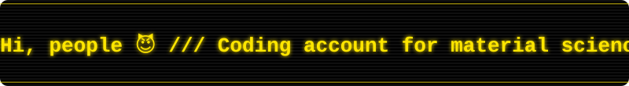

> ⚠️ **Caution: Please do not follow me.** This is only my private account.
> But feel free to leave comments or review my repos!

---

### 🧪 Material Science · 🧬 Biochem · 🐍 Python

- 🔬 Interested in: materials, proteins, and simulations
- 🐍 Currently learning: Python with Pygame

### 🛠 Tech

### 📊 Stats

